> **Uyarı:** Bu içerik, SCÜ Şarkışla UBYO Mobil Programlama I dersi kapsamında tamamen eğitim amaçlı çevrilmiş ve derlenmiştir. Orijinal dokümantasyon kaynakları (dart.dev, docs.flutter.dev) kendi orijinal lisanslarına (BSD-3-Clause, CC-BY 4.0) tabidir. Bu çalışmanın hiçbir ticari amacı yoktur.

---

# Navigasyon ve Yönlendirme — Flutter

**Mobil Programlama I · 2026 Güz · Takım: PUSULA**

Bu metin, derste hazırlanan 39 sayfalık Türkçe çeviri/mizanpaj belgesinin GitHub için düzenlenmiş sürümüdür. Kod örnekleri mümkün olan yerlerde kopyalanabilir metne dönüştürülmüştür; görseller ve diğer kaynak örnekleri ise özgün belgedeki sıraları korunarak eklenmiştir.

**Kaynaklar:** [Flutter — Navigation and routing](https://docs.flutter.dev/ui/navigation) · [Flutter Cookbook — Navigation](https://docs.flutter.dev/cookbook/navigation)

## İçindekiler

1. [Navigator Kullanımı](#navigator-kullanimi)
2. [Router Kullanımı](#router-kullanimi)
3. [Router ve Navigator'ı Birlikte Kullanma](#router-ve-navigatori-birlikte-kullanma)
4. [Web Desteği](#web-destegi)
5. [Sekmelerle Çalışma](#sekmelerle-calisma)
6. [Yeni bir ekrana gitme ve geri dönme](#yeni-bir-ekrana-gitme-ve-geri-donme)
7. [Yeni bir ekrana veri gönderme](#yeni-bir-ekrana-veri-gonderme)
8. [Bir ekrandan veri geri döndürme](#bir-ekrandan-veri-geri-dondurme)
9. [Bir ekrana çekmece (drawer) ekleme](#bir-ekrana-cekmece-drawer-ekleme)
10. [Cupertino Sayfası Görüntüleme](#cupertino-sayfasi-goruntuleme)
11. [Derin Bağlantı (Deep Linking)](#derin-baglanti-deep-linking)
12. [Android için uygulama bağlantıları kurun.](#android-icin-uygulama-baglantilari-kurun)
13. [iOS İçin Universal Links (Evrensel Bağlantılar) Ayarlama](#ios-icin-universal-links-evrensel-baglantilar-ayarlama)
14. [Web üzerinde URL stratejisinin yapılandırılması](#web-uzerinde-url-stratejisinin-yapilandirilmasi)

---

> Flutter'ın navigasyon ve yönlendirme özelliklerine genel bakış

Flutter, ekranlar arasında gezinmek ve derin bağlantıları (deep link) yönetmek için eksiksiz bir sistem sunar. Karmaşık derin bağlantı gereksinimleri olmayan küçük uygulamalar Navigator kullanabilirken; özel derin bağlantı ve gezinme gereksinimleri olan uygulamaların, Android ve iOS'ta derin bağlantıları doğru şekilde yönetebilmesi ve uygulama web üzerinde çalışırken adres çubuğuyla senkronize kalabilmesi için Router'ı da kullanması gerekir.

Android veya iOS uygulamanızı derin bağlantıları yönetecek şekilde yapılandırmak için "Deep linking" (Derin bağlantı) bölümüne bakın.

<a id="navigator-kullanimi"></a>

## Navigator Kullanımı

Navigator bileşeni, hedef platform için doğru geçiş animasyonlarını kullanarak ekranları bir yığın (stack) olarak gösterir. Yeni bir ekrana gitmek için rotanın BuildContext nesnesi üzerinden Navigator'a erişin ve push() veya pop() gibi zorunlu (imperative) metotları çağırın:

```dart
child: const Text('Open second screen'),
onPressed: () {
  Navigator.of(context).push(
    MaterialPageRoute<void>(
      builder: (context) => const SecondScreen(),
    ),
  );
},
```

Navigator, (geçmiş yığınını temsil eden) bir Route nesneleri yığını tuttuğundan, push() yöntemi de bir Route nesnesi alır. MaterialPageRoute nesnesi, Material Design için geçiş animasyonlarını belirten bir Route alt sınıfıdır. Navigator'ın nasıl kullanılacağına dair daha fazla örnek için Flutter Cookbook'taki navigasyon tariflerini takip edin veya Navigator API belgelerini ziyaret edin.

### Adlandırılmış rotaları kullanma

> **Not:** Çoğu uygulama için adlandırılmış rotalar önerilmez. Bunun yerine `go_router` gibi bir yönlendirme paketi veya `Navigator` ile birlikte `MaterialPageRoute` kullanılması tavsiye edilir. Ayrıntı için aşağıdaki **Sınırlamalar** bölümüne bakın.

Basit gezinme ve derin bağlantı gereksinimleri olan uygulamalar, gezinme için Navigator'ı ve derin bağlantılar için MaterialApp.routes parametresini kullanabilir:

```dart
child: const Text('Open second screen'),
onPressed: () {
  Navigator.pushNamed(context, '/second');
},
```

/second, MaterialApp.routes listesinde tanımlanmış olan adlandırılmış bir rotayı (named route) temsil eder. Eksiksiz bir örnek için Flutter Cookbook'taki "Navigate with named routes"([Adlandırılmış rotalarla gezinme](https://docs.flutter.dev/cookbook/navigation/named-routes)) tarifini takip edin.

### Sınırlamalar

Adlandırılmış rotalar derin bağlantıları işleyebilse de davranış her zaman aynıdır ve özelleştirilemez. Platform tarafından yeni bir derin bağlantı alındığında Flutter, kullanıcı şu an nerede olursa olsun Navigator üzerine yeni bir Route atar.

Flutter ayrıca adlandırılmış rotaları kullanan uygulamalar için tarayıcı ileri düğmesini desteklemez. Bu nedenlerden dolayı, adlandırılmış rotaların çoğu uygulamada kullanılmasını önermiyoruz. Bunun yerine go_router gibi bir yönlendirme paketi kullanın veya MaterialPageRoute ile Navigator kullanın.

<a id="router-kullanimi"></a>

## Router Kullanımı

Gelişmiş gezinme ve yönlendirme gereksinimleri olan Flutter uygulamaları (her ekrana doğrudan bağlantılar kullanan bir web uygulaması veya birden fazla Navigator bileşeni içeren bir uygulama gibi), uygulama yeni bir derin bağlantı aldığında rota yolunu ayrıştırabilen ve Navigator'ı yapılandırabilen go_router gibi bir yönlendirme paketi kullanmalıdır.

Router'ı kullanmak için MaterialApp veya CupertinoApp üzerindeki router kurucusuna geçiş yapın ve buraya bir Router yapılandırması sağlayın. go_router gibi yönlendirme paketleri tipik olarak rota yapılandırması sağlar ve rotalar aşağıdaki gibi kullanılabilir:

```dart
child: const Text('Open second screen'),
onPressed: () => context.go('/second'),
```

go_router gibi paketler bildirimsel (declarative) olduğundan, bir derin bağlantı alındığında her zaman aynı ekranı veya ekranları göstereceklerdir.

> **İleri düzey geliştiriciler için not:** Bir yönlendirme paketi kullanmıyorsanız `RouteInformationParser`, `RouterDelegate` ve `Navigator.pages` üzerinden sayfa yığınını kendiniz yönetebilirsiniz. Ayrıntılar için Flutter Router API belgelerine başvurun.

<a id="router-ve-navigatori-birlikte-kullanma"></a>

## Router ve Navigator'ı Birlikte Kullanma

Router ve Navigator birlikte çalışacak şekilde tasarlanmıştır. go_router gibi bildirimsel (declarative) bir yönlendirme paketi aracılığıyla Router API'sini kullanarak veya Navigator üzerinde push() ve pop() gibi zorunlu (imperative) yöntemleri çağırarak gezinebilirsiniz.

Router veya bildirimsel bir yönlendirme paketi kullanarak gezindiğinizde, Navigator üzerindeki her rota sayfa desteklidir (page-backed); yani Navigator kurucusundaki pages argümanı kullanılarak bir Page'den oluşturulmuştur. Buna karşılık, Navigator.push veya showDialog çağrılarak oluşturulan herhangi bir Route, Navigator'a sayfasız (pageless) bir rota ekleyecektir. Bir yönlendirme paketi kullanıyorsanız, sayfa destekli rotalar her zaman derin bağlantı alabilirken, sayfasız rotalar alamaz.

Sayfa destekli bir Route, Navigator'dan kaldırıldığında, ondan sonra gelen tüm sayfasız rotalar da kaldırılır. Örneğin, bir derin bağlantı Navigator'dan sayfa destekli bir rotayı kaldırarak gezinirse, sonrasındaki tüm sayfasız rotalar da (bir sonraki sayfa destekli rotaya kadar) kaldırılır.

> **Not:** Sayfa tabanlı navigasyonu engellemek veya sayfayı kullanımdan kaldırılan `WillPopScope` ile yönetmek yerine yönlendirme paketinin API belgelerine ve `PopScope` kullanımına bakın.

<a id="web-destegi"></a>

## Web Desteği

Router sınıfını kullanan uygulamalar, tarayıcının geri ve ileri düğmelerini kullanırken tutarlı bir deneyim sunmak için tarayıcı History API'si ile entegre olur. Router kullanarak her gezindiğinizde, tarayıcının geçmiş yığınına bir History API girdisi eklenir. **Geri düğmesine basmak**, ters kronolojik gezinme kullanır; yani kullanıcı, Router kullanılarak gösterilen daha önce ziyaret edilmiş konuma götürülür. Bu, kullanıcının Navigator'dan bir sayfayı kaldırması ve ardından tarayıcı **geri** düğmesine basması durumunda önceki sayfanın yığına geri ekleneceği anlamına gelir.

<a id="sekmelerle-calisma"></a>

## Sekmelerle Çalışma

**Bir düzen içerisinde sekmelerin nasıl uygulanacağı?**

Sekmelerle çalışmak, Material Design yönergelerini takip eden uygulamalarda yaygın bir desendir. Flutter, material kütüphanesinin bir parçası olarak sekme düzenleri oluşturmanın kolay bir yolunu sunar.

Bu tarif, aşağıdaki adımları kullanarak sekmeli bir örnek oluşturur:

1. Bir `TabController` oluşturun.

2. Sekmeleri oluşturun.

3. Her sekme için içerik oluşturun.

1.  **Bir TabController Oluşturun**

Sekmelerin çalışması için, seçilen sekme ile içerik bölümlerini senkronize tutmanız gerekir. Bu, TabController'ın(bileşenlerin) görevidir.

Ya manuel olarak bir TabController oluşturun ya da DefaultTabController bileşenini kullanarak bunu otomatik olarak yapın.

DefaultTabController kullanmak en basit seçenektir; çünkü bir TabController oluşturur ve bunu tüm alt (descendant) bileşenler için kullanılabilir hale getirir.

```dart
return MaterialApp(
  home: DefaultTabController(length: 3, child: Scaffold()),
);
```

### 2.Sekmeleri Oluşturun

Bir sekme seçildiğinde, içeriği görüntülemesi gerekir. TabBar bileşenini kullanarak sekmeler oluşturabilirsiniz. Bu örnekte, üç adet Tab bileşenine sahip bir TabBar oluşturun ve bunu bir AppBar içine yerleştirin.

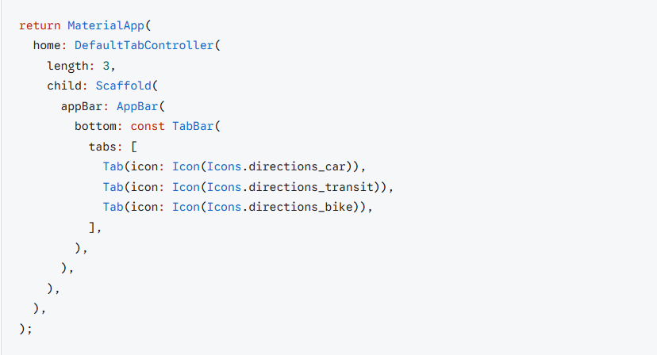

Varsayılan olarak TabBar, en yakın DefaultTabController'ı bulmak için bileşen ağacında yukarı doğru arama yapar. Eğer TabController'ı manuel olarak oluşturuyorsanız, bunu TabBar'a iletin.

### 3.Her Sekme İçin İçerik Oluşturun

Artık sekmeleriniz olduğuna göre, bir sekme seçildiğinde içeriği görüntüleyin. Bu amaçla TabBarView bileşenini kullanın.

> **Not:** `TabBar` sekmeleri ile `TabBarView` içeriklerinin sırası aynı olmalıdır.

```dart
body: const TabBarView(
  children: [
    Icon(Icons.directions_car),
    Icon(Icons.directions_transit),
    Icon(Icons.directions_bike),
  ],
),
```

<a id="yeni-bir-ekrana-gitme-ve-geri-donme"></a>

## Yeni bir ekrana gitme ve geri dönme

**Rotalar arasında nasıl gezinilir?**

Çoğu uygulama, farklı bilgi türlerini görüntülemek için birkaç ekran içerir. Örneğin, bir uygulamanın ürünleri listeleyen bir ekranı olabilir. Kullanıcı bir ürünün görseline dokunduğunda, yeni bir ekran ürün hakkındaki detayları gösterir.

> **Terminoloji:** Flutter'da ekranlar ve sayfalar “rota” olarak adlandırılır.

Android'de bir rota (route), bir Activity'ye eşdeğerdir. iOS'ta bir rota, bir ViewController'a eşdeğerdir. Flutter'da ise rota sadece bir bileşendir (widget).

Bu tarif, yeni bir rotaya geçmek için Navigator'ı kullanır.

Sonraki birkaç bölüm, şu adımları kullanarak iki rota arasında nasıl gezinileceğini göstermektedir:

**1.**İki rota oluşturun.

**2.**Navigator.push() kullanarak ikinci rotaya gidin.

**3.**Navigator.pop() kullanarak ilk rotaya geri dönün.

### İki Rota Oluşturun

İlk olarak, üzerinde çalışılacak iki rota oluşturun. Bu temel bir örnek olduğundan, her rota yalnızca tek bir düğme içerir. İlk rotadaki düğmeye dokunmak ikinci rotaya götürür. İkinci rotadaki düğmeye dokunmak ise ilk rotaya geri döndürür.

Öncelikle görsel yapıyı ayarlayın:

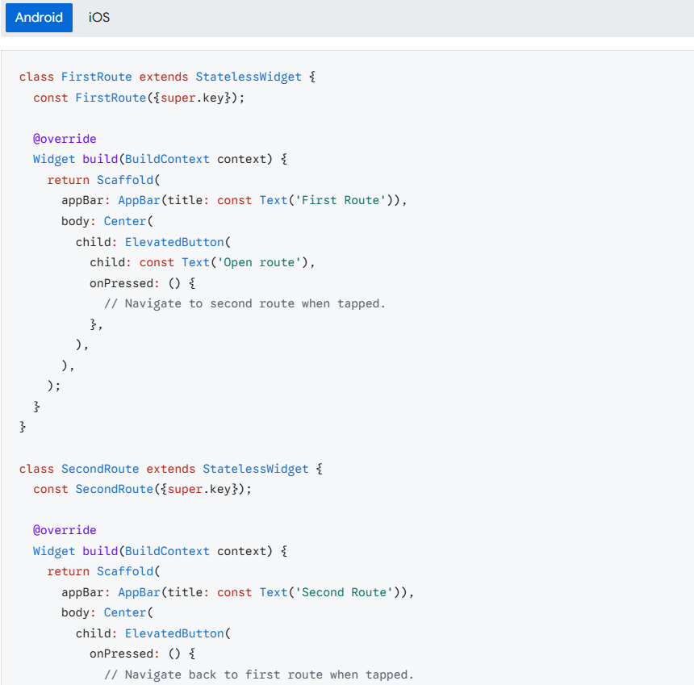

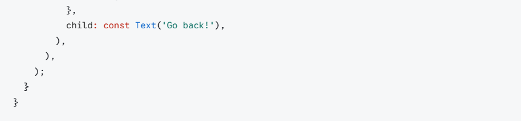

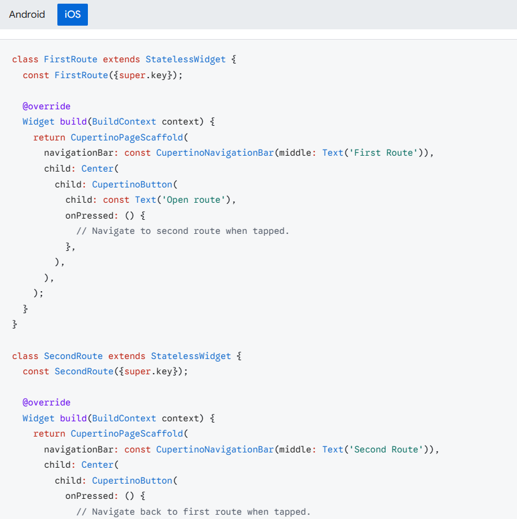

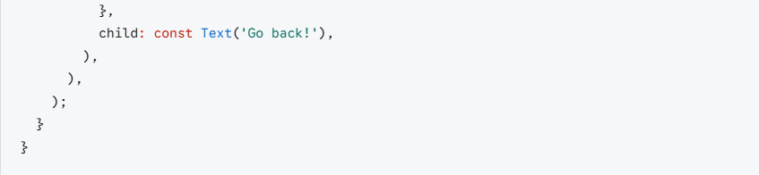

### 2.Navigator.push() Kullanarak İkinci Rotaya Gitme

Yeni bir rotaya geçmek için Navigator.push() yöntemini kullanın. push() yöntemi, Navigator tarafından yönetilen rota yığınındakilere bir Route ekler. Route nereden gelir? Kendi rotanızı oluşturabilir veya MaterialPageRoute ya da CupertinoPageRoute gibi platforma özgü bir rota kullanabilirsiniz. Platforma özgü bir rota kullanışlıdır çünkü platforma özgü bir animasyon kullanarak yeni rotaya geçiş yapar.

FirstRoute bileşeninin build() yönteminde, onPressed() geri çağrısını güncelleyin:

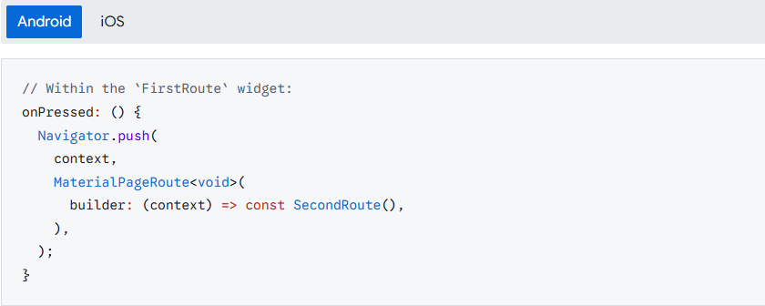

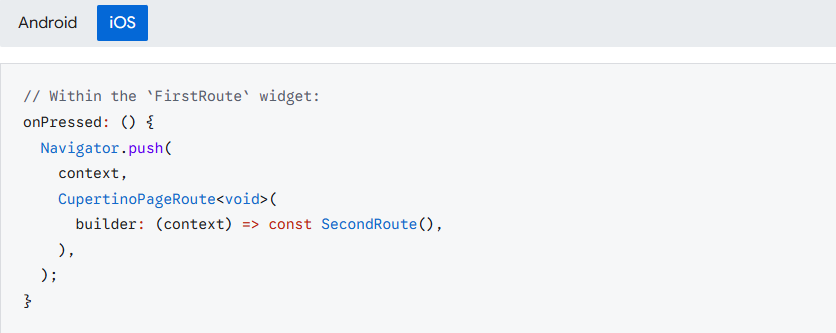

### 3.Navigator.pop() Kullanarak İlk Rotaya Geri Dönme

İkinci rotayı nasıl kapatır ve ilk rotaya geri dönersiniz? Navigator.pop() yöntemini kullanarak. pop() yöntemi, mevcut Route öğesini Navigator tarafından yönetilen rota yığınından çıkarır.

Orijinal rotaya dönüşü uygulamak için, SecondRoute bileşenindeki onPressed() geri çağrısını güncelleyin:

```dart
// Within the SecondRoute widget
onPressed: () {
  Navigator.pop(context);
},
```

<a id="yeni-bir-ekrana-veri-gonderme"></a>

## Yeni bir ekrana veri gönderme

**Yeni bir rotaya veri nasıl aktarılır?**

Genellikle sadece yeni bir ekrana geçiş yapmakla kalmaz, aynı zamanda o ekrana veri de aktarmak istersiniz. Örneğin, dokunulan öge hakkındaki bilgileri iletmek isteyebilirsiniz.

Unutmayın: Ekranlar yalnızca birer widget'tır. Bu örnekte, yapılacaklar listesi (todos) oluşturun. Bir göreve dokunulduğunda, o görevle ilgili bilgileri görüntüleyen yeni bir ekrana (widget'a) geçiş yapın. Bu yönerge şu adımları kullanır:

1.Bir todo (yapılacaklar) sınıfı tanımlayın.

2.Yapılacaklar listesini görüntüleyin.

3.Bir yapılacak iş hakkında bilgi görüntüleyebilen bir detay ekranı oluşturun.

4.Detay ekranına geçiş yapın ve veriyi aktarın.  
  
**1.Bir todo sınıfı tanımlayın**: İlk olarak, yapılacak işleri temsil edecek basit bir yola ihtiyacınız vardır. Bu örnek için, iki parça veri içeren bir sınıf oluşturun: başlık ve açıklama.

```dart
class Todo {
  final String title;
  final String description;

  const Todo(this.title, this.description);
}
```

**2. Bir yapılacaklar listesi oluşturun:** İkinci olarak, bir yapılacaklar listesi görüntüleyin. Bu örnekte 20 adet yapılacak iş (todo) üretin ve bunları bir ListView kullanarak gösterin. Listelerle çalışma hakkında daha fazla bilgi için *Listeleri Kullanma* (Use lists) yönergesine bakın.

Yapılacaklar listesini oluşturun (üretin)  
```dart
final todos = List.generate(
  20,
  (i) => Todo(
    'Todo $i',
    'A description of what needs to be done for Todo $i',
  ),
);
```  
  
Yapılacaklar listesini bir ListView kullanarak görüntüleyin

```dart
ListView.builder(
  itemCount: todos.length,
  itemBuilder: (context, index) {
    return ListTile(title: Text(todos[index].title));
  },
)
```

Şimdiye kadar her şey yolunda. Bu, 20 adet yapılacak iş (todo) üretir ve bunları bir ListView içinde görüntüler.

### 3. Listeyi görüntülemek için bir Todo ekranı oluşturun

Bunun için bir <span class="mark">StatelessWidget</span> oluşturuyoruz. Buna <span class="mark">TodosScreen</span> adını veriyoruz. Bu sayfanın içeriği çalışma zamanında (runtime) değişmeyeceği için, yapılacaklar listesini (todos) bu widget'ın kapsamı dahilinde zorunlu kılmamız gerekecek.  
  
<span class="mark">ListView.builder</span> bileşenimizi, <span class="mark">build()</span>. metoduna döndürdüğümüz widget'ın gövdesi (body) olarak iletiyoruz. Bu, başlamanızı sağlamak için listeyi ekranda oluşturacaktır (render edecektir)!  
  
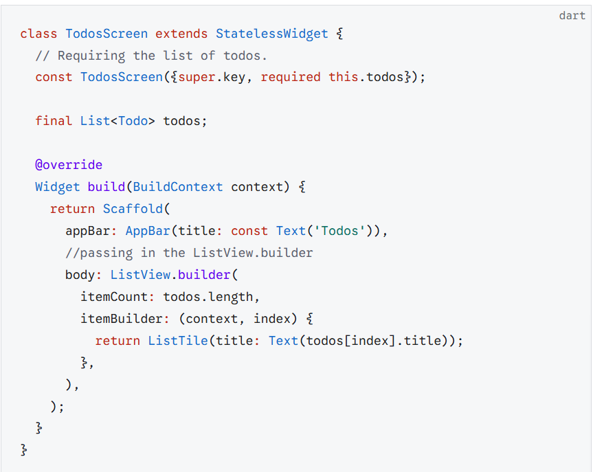

Flutter'ın varsayılan stillendirmesi sayesinde, daha sonra yapmak isteyeceğiniz şeyler için hiç ter dökmeden (zahmete girmeden) yola koyulmaya hazırsınız!

4.  **Bir yapılacak iş hakkında bilgi görüntülemek için bir detay ekranı oluşturun**

**  
**Şimdi ikinci ekranı oluşturun. Ekranın başlığı yapılacak işin (todo) başlığını içerir ve ekranın gövdesi (body) ise açıklamayı gösterir.  
Detay ekranı normal bir <span class="mark">StatelessWidget</span> olduğundan, kullanıcıdan kullanıcı arayüzünde (UI) bir <span class="mark">Todo</span> girmesini zorunlu kılın. Ardından, verilen todo'yu kullanarak kullanıcı arayüzünü (UI) oluşturun.  
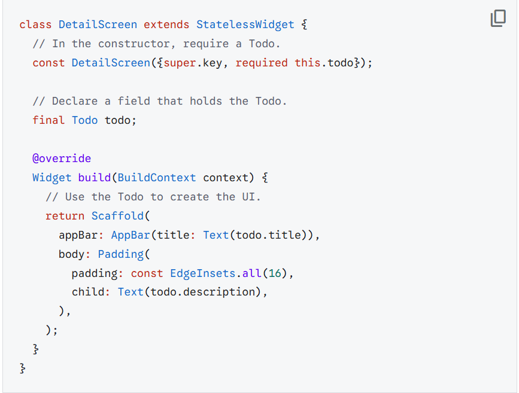  
  
### 5. Detay ekranına geçiş yapın ve veriyi aktarın

Bir <span class="mark">DetailScreen</span> hazır olduğunda, gezinme (Navigation) işlemini gerçekleştirmeye hazırsınız. Bu örnekte, bir kullanıcı listedeki bir yapılacak işe (todo) dokunduğunda <span class="mark">DetailScreen</span> ekranına geçiş yapın. Todo nesnesini <span class="mark">DetailScreen'e</span> iletin.

<span class="mark">TodosScreen</span> üzerinde kullanıcının dokunmasını yakalamak için, ListTile widget'ına bir <span class="mark">onTap()</span> geri çağırma fonksiyonu (callback) yazın. <span class="mark">onTap()</span> fonksiyonunun içinde <span class="mark">Navigator.push()</span> metodunu kullanın.  
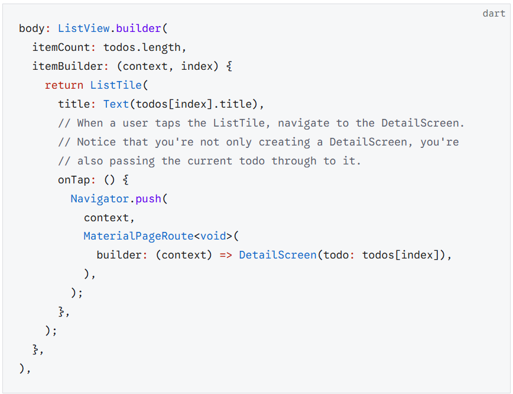  
**Alternatif olarak, argümanları RouteSettings kullanarak aktarın  
**İlk iki adımı tekrarlayın.

Argümanları çıkarmak (ayıklamak) için bir detay ekranı oluşturun

Ardından, <span class="mark">Todo</span> nesnesinden başlığı ve açıklamayı çıkaran ve görüntüleyen bir detay ekranı oluşturun. <span class="mark">Todo</span> nesnesine erişmek için ModalRoute.of() metodunu kullanın. Bu metot, mevcut rotayı argümanlarıyla birlikte döndürür.

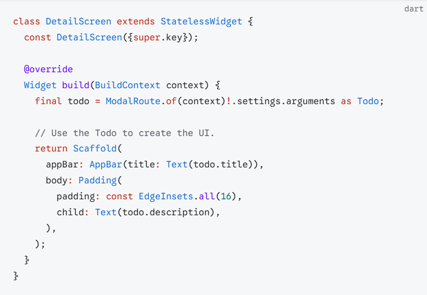

### Detay ekranına geçiş yapın ve argümanları aktarın

Son olarak, bir kullanıcı <span class="mark">Navigator.push()</span> yöntemini kullanarak bir <span class="mark">ListTile</span> widget'ına dokunduğunda <span class="mark">DetailScreen</span> ekranına geçiş yapın. Argümanları <span class="mark">RouteSettings'in</span> bir parçasıolarak iletin. <span class="mark">DetailScreen</span> bu argümanları çıkarır (ayıklar).

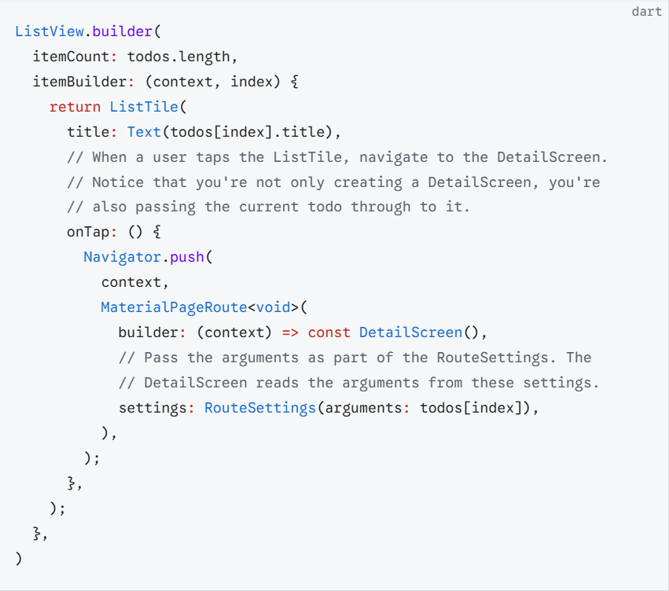

### Eksiksiz (tam) örnek:

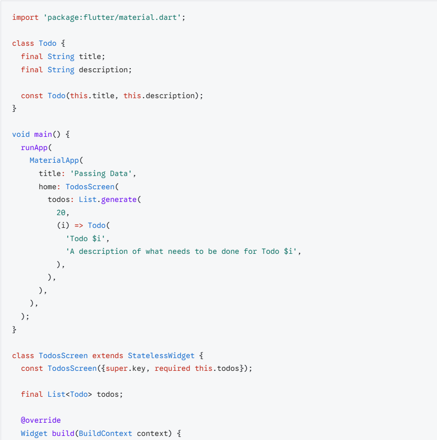

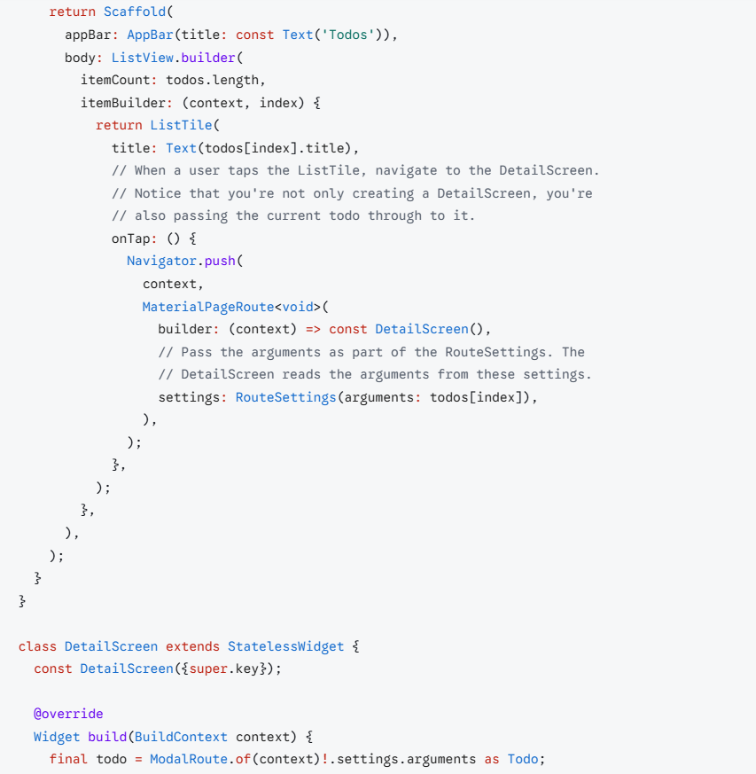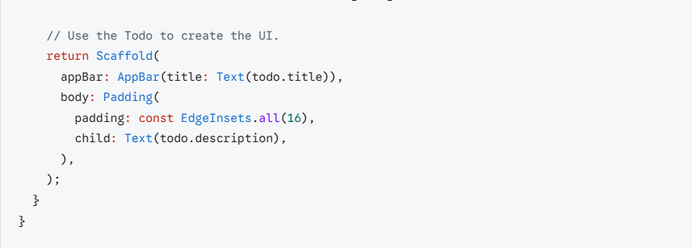

<a id="bir-ekrandan-veri-geri-dondurme"></a>

## Bir ekrandan veri geri döndürme

**Yeni bir ekrandan veri nasıl geri döndürülür?**

**  
**Bazı durumlarda, yeni bir ekrandan veri geri döndürmek isteyebilirsiniz. Örneğin, kullanıcıya iki seçenek sunan yeni bir ekrana geçiş yaptığınızı (push ettiğinizi) varsayalım. Kullanıcı bir seçeneğe dokunduğunda, bu bilgi doğrultusunda işlem yapabilmesi için ilk ekranı kullanıcının seçimi hakkında bilgilendirmek istersiniz.

Bunu, aşağıdaki adımları kullanarak Navigator.pop() metodu ile yapabilirsiniz:

Bunu, aşağıdaki adımları kullanarak Navigator.pop() metodu ile yapabilirsiniz:

1.Ana ekranı tanımlayın  
2.Seçim ekranını başlatan bir buton ekleyin  
3.Seçim ekranını iki buton ile gösterin  
  
4.Bir butona dokunulduğunda seçim ekranını kapatın  
5. Ana ekranda yapılan seçimle birlikte bir snackbar (bilgi çubuğu) gösterin  
  
### 1. Ana ekranı tanımlayın

Ana ekran bir buton görüntüler. Dokunulduğunda, seçim ekranını başlatır.

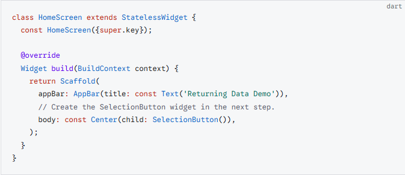

### 2. Seçim ekranını başlatan bir buton ekleyin

Şimdi aşağıdakileri yapan SelectionButton'ı oluşturun:

- Dokunulduğunda SelectionScreen'i başlatır.

- SelectionScreen'in bir sonuç döndürmesini bekler.

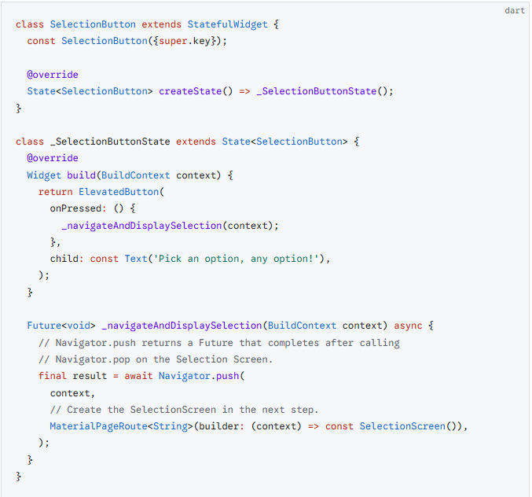

### 3. Seçim ekranını iki buton ile gösterin

Şimdi iki buton içeren bir seçim ekranı oluşturun. Kullanıcı bir butona dokunduğunda, uygulama seçim ekranını kapatır ve ana ekranın hangi butona dokunulduğunu bilmesini sağlar.

Bu adım kullanıcı arayüzünü (UI) tanımlar. Bir sonraki adım ise veri döndürmek için gerekli kodu ekler.

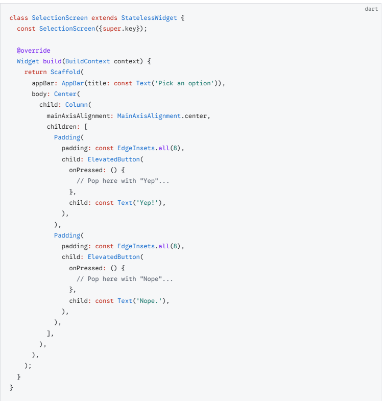

### 4. Bir butona dokunulduğunda seçim ekranını kapatın

Şimdi her iki buton için de <span class="mark">onPressed()</span> geri çağırma fonksiyonunu (callback) güncelleyin. İlk ekrana veri döndürmek için, <span class="mark">result</span> adında isteğe bağlı (optional) ikinci bir argüman kabul eden Navigator.pop() metodunu kullanın. Herhangi bir sonuç, SelectionButton içindeki <span class="mark">Future'a</span> geri döndürülür.

Evet! (Yep) butonu

```dart
ElevatedButton(
  onPressed: () {
    // Close the screen and return 'Yep!' as the result.
    Navigator.pop(context, 'Yep!');
  },
  child: const Text('Yep!'),
)
```

(Nope!) butonu / Hayır butonu  
```dart
ElevatedButton(
  onPressed: () {
    // Close the screen and return 'Nope.' as the result.
    Navigator.pop(context, 'Nope.');
  },
  child: const Text('Nope.'),
)
```

### 5. Ana ekranda yapılan seçimle birlikte bir snackbar gösterin

Artık bir seçim ekranı başlattığınıza ve sonucu beklediğinize göre, geri dönen bilgiyle bir şeyler yapmak isteyeceksiniz.

Bu durumda, <span class="mark">SelectionButton</span> içindeki <span class="mark">\_navigateAndDisplaySelection()</span> metodunu kullanarak sonucu görüntüleyen bir snackbar (bilgi çubuğu) gösterin:

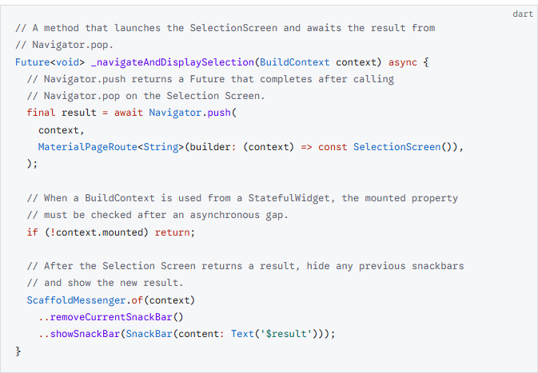

<a id="bir-ekrana-cekmece-drawer-ekleme"></a>

## Bir ekrana çekmece (drawer) ekleme

**Material Çekmecesi (Drawer) nasıl uygulanır?**

**  
**Material Design kullanan uygulamalarda gezinme (navigation) için iki temel seçenek vardır: sekmeler (tabs) ve çekmeceler (drawers). Sekmeleri desteklemek için yeterli alan olmadığında, çekmeceler kullanışlı bir alternatif sunar.

Flutter'da Material Design çekmecesine sahip bir düzen (layout) oluşturmak için Scaffold ile birlikte Drawer widget'ını kullanın. Bu tarif (recipe) aşağıdaki adımları kullanır:

1.  Bir Scaffold oluşturun.

2.  Bir çekmece (drawer) ekleyin.

3.  Çekmeceyi ögelerle doldurun.

4.  Çekmeceyi programatik olarak kapatın.

### 1. Bir Scaffold oluşturun

Uygulamaya bir çekmece eklemek için onu bir Scaffold widget'ı ile sarın. <span class="mark">Scaffold</span> widget'ı, Material Design Yönergelerini (Material Design Guidelines) takip eden uygulamalara tutarlı bir görsel yapı sağlar. Ayrıca Drawers, AppBars ve SnackBars gibi özel Material Design bileşenlerini de destekler.

Bu örnekte, çekmecesi <span class="mark">(drawer)</span> olan bir <span class="mark">Scaffold</span> oluşturun:

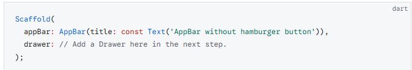

### 2. Bir çekmece (drawer) ekleyin

Şimdi <span class="mark">Scaffold'a</span> bir çekmece ekleyin. Bir çekmece herhangi bir widget olabilir, ancak genellikle Material Design standartlarına uygun olan material kütüphanesindeki <span class="mark">Drawer</span> widget'ını kullanmak en iyisidir.

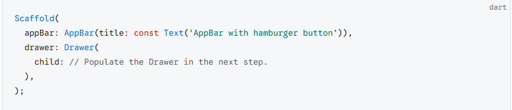

### 3. Çekmeceyi ögelerle doldurun

Artık yerinde bir <span class="mark">Drawer</span> bulunduğuna göre, içine içerik ekleyin. Bu örnek için bir ListView kullanın. Bir <span class="mark">Column</span> widget'ı da kullanabilecek olsanız da , <span class="mark">ListView</span> oldukça kullanışlıdır çünkü içerik ekranın desteklediğinden daha fazla alan kaplarsa kullanıcıların çekmece içinde kaydırma (scroll) yapmasına olanak tanır.

<span class="mark">ListView</span>'u bir DrawerHeader ve iki ListTile widget'ı ile doldurun. Listelerle çalışma hakkında daha fazla bilgi için liste tariflerine (list recipes) göz atın.

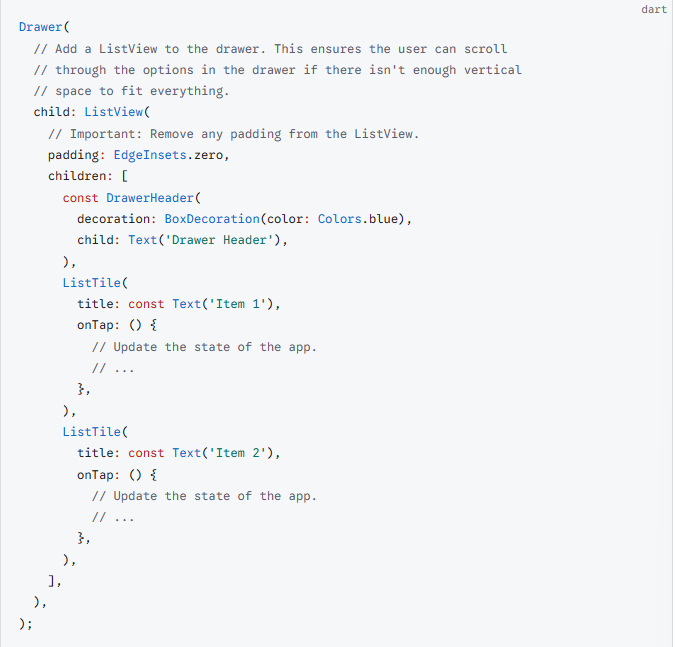

### 4. Çekmeceyi programatik olarak açın

Genellikle bir çekmeceyi açmak için herhangi bir kod yazmanız gerekmez; çünkü <span class="mark">leading</span> widget'ı null olduğunda, <span class="mark">AppBar</span> içindeki varsayılan uygulama <span class="mark">DrawerButton</span>'dır.

Ancak çekmece üzerinde tam kontrole sahip olmak istiyorsanız, bunu <span class="mark">Builder</span> kullanarak <span class="mark">Scaffold.of(context).openDrawer()</span> çağrısıyla yapabilirsiniz.

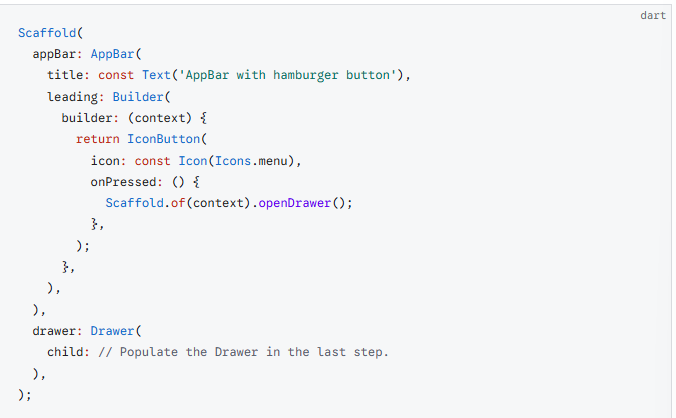  
  
### 5. Çekmeceyi programatik olarak kapatın

Bir kullanıcı bir ögeye dokunduktan sonra çekmeceyi kapatmak isteyebilirsiniz. Bunu Navigator kullanarak yapabilirsiniz.

Kullanıcı çekmeceyi açtığında, Flutter çekmeceyi gezinme yığınına (navigation stack) ekler. Bu nedenle çekmeceyi kapatmak için <span class="mark">Navigator.pop(context)</span> çağrısını yapın.

```dart
ListTile(
  title: const Text('Item 1'),
  onTap: () {
    // Update the state of the app.
    // ...
    // Then close the drawer.
    Navigator.pop(context);
  },
),
```  
  
### Etkileşimli örnek

Bu örnek, bir Drawer'ın Scaffold widget'ı içinde nasıl kullanıldığını gösterir. Drawer üç adet ListTile ögesine sahiptir. <span class="mark">\_onItemTapped</span> fonksiyonu seçilen ögenin indeksini değiştirir ve buna karşılık gelen metni <span class="mark">Scaffold</span>'un merkezinde görüntüler.

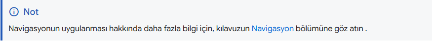

<a id="cupertino-sayfasi-goruntuleme"></a>

## Cupertino Sayfası Görüntüleme

**Mesajları ve içeriği görüntülemek için bir Cupertino sayfası (sheet) nasıl uygulanır.**

Bir Cupertino sayfası (Cupertino sheet), içerik veya seçenekleri sunmak için kullanılan iOS tarzı bir modal alt sayfadır (bottom sheet). Ekranın altından yukarı doğru kayarak açılır ve kapatılmak üzere aşağı doğru çekilebilir.

Flutter'da bu işi showCupertinoSheet yapar. Bu tarif, aşağıdaki adımları kullanarak bir Cupertino sayfası uygular:

**1.**Bir CupertinoApp veya MaterialApp oluşturun.

**2.**Sayfa içeriğini görüntüleyin.

1.  **Bir CupertinoApp Oluşturun**

iOS tasarım yönergelerini takip eden uygulamalar oluştururken CupertinoApp kullanabilirsiniz. Aşağıdaki örnek, ekranın ortasında modalı tetikleyen bir düğme sağlar.

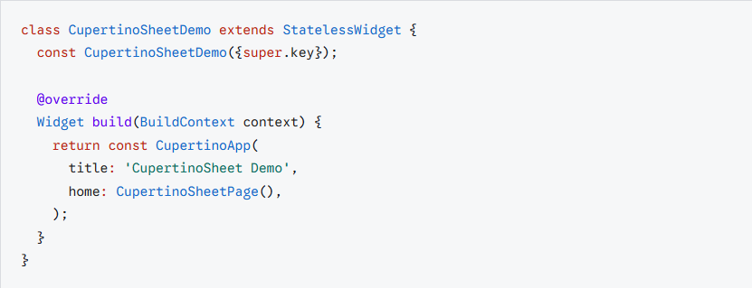

2.  **Sayfa İçeriğini Görüntüleme**

Temel uygulama yapısı hazır olduğunda, sayfayı görüntüleyin. Sayfayı göstermek için showCupertinoSheet fonksiyonunu çağırın ve SingleChildScrollView gibi sayfa için içeriği döndüren bir scrollableBuilder sağlayın.

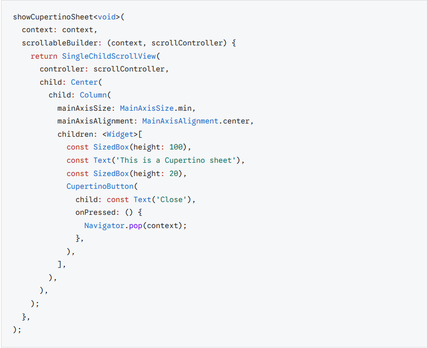

<a id="derin-baglanti-deep-linking"></a>

## Derin Bağlantı (Deep Linking)

### Uygulama yeni bir URL aldığında rotalara gitme.

Derin bağlantılar (deep links), yalnızca bir uygulamayı açmakla kalmayıp aynı zamanda kullanıcıyı uygulamanın "derinliklerindeki" belirli bir konuma götüren bağlantılardır. Örneğin, bir spor ayakkabı reklamındaki derin bağlantı, bir alışveriş uygulamasını açabilir ve bu spesifik ayakkabıların ürün sayfasını görüntüleyebilir.

Flutter, iOS, Android ve web üzerinde derin bağlantıları destekler. Bir URL'yi açmak, uygulamanızda ilgili ekranı gösterir. Aşağıdaki adımlarla, adlandırılmış rotaları (routes parametresi veya onGenerateRoute kullanarak) ya da Router bileşenini kullanarak rotaları başlatabilir ve görüntüleyebilirsiniz.

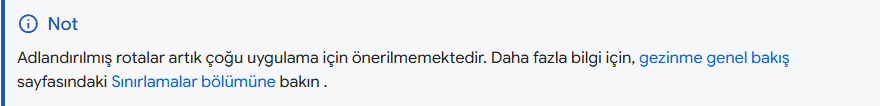

Uygulamayı bir web tarayıcısında çalıştırıyorsanız, ek bir kurulum gerekmez. Rota yolları, bir iOS veya Android derin bağlantısıyla aynı şekilde işlenir. Varsayılan olarak web uygulamaları, /#/path/to/app/screen kalıbını kullanarak URL parçasından derin bağlantı yolunu okur; ancak bu durum, uygulamanız için URL stratejisini yapılandırarak değiştirilebilir.

Görsel öğrenmeyi tercih ediyorsanız, aşağıdaki videoya göz atın:

<https://www.youtube.com/watch?v=KNAb2XL7k2g>

### Eklenti tabanlı derin bağlantılardan (deep linking) geçiş yapma

Derin bağlantıları yönetmek için bir eklenti yazdıysanız (Deep Links and Flutter applications adlı Medium'daki ücretsiz makaledte anlatıldığı gibi), Flutter'ın varsayılan derin bağlantı işleyicisini devre dışı bırakmalısınız. Bunu yapmak için, Info.plist dosyasında FlutterDeepLinkingEnabled değerini false olarak ayarlayın veya AndroidManifest.xml dosyasında flutter_deeplinking_enabled değerini false yapın.

### Davranış

Davranış, platforma ve uygulamanın başlatılıp çalıştırılma durumuna bağlı olarak hafifçe değişiklik gösterir.

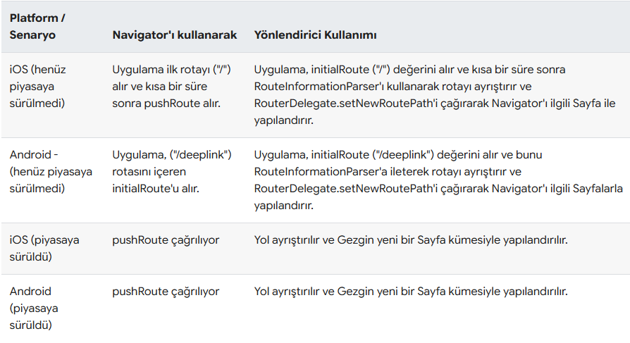

Router bileşenini kullanırken uygulamanız, uygulama çalışırken yeni bir derin bağlantı açıldığında mevcut sayfa setini değiştirme yeteneğine sahiptir.

<a id="android-icin-uygulama-baglantilari-kurun"></a>

## Android için uygulama bağlantıları kurun.

Flutter ile geliştirilmiş bir Android uygulaması için uygulama bağlantılarının nasıl kurulacağını öğrenin.

Derin bağlantı (deep linking), bir uygulamayı bir URI ile başlatmak için kullanılan bir mekanizmadır. Bu URI şema (scheme), ana bilgisayar (host) ve yol (path) içerir ve uygulamayı belirli bir ekranda açar.

Uygulama bağlantısı (app link), http veya https kullanan ve yalnızca Android cihazlara özgü bir derin bağlantı türüdür.

Uygulama bağlantılarını ayarlamak bir web alan adınızın (domain) olmasını gerektirir. Aksi takdirde geçici bir çözüm olarak Firebase Hosting veya GitHub Pages kullanmayı düşünün.

Derin bağlantılarınızı ayarladıktan sonra bunları doğrulayabilirsiniz. Daha fazla bilgi edinmek için Derin bağlantıları doğrulama bölümüne bakın.

### 1.Bir Flutter Uygulamasını Özelleştirme

Gelen bir URL'yi işleyebilen bir Flutter uygulaması yazın. Bu örnek, yönlendirmeyi yönetmek için go_router paketini kullanır. go_router paketi Flutter ekibi tarafından sürdürülür ve karmaşık yönlendirme senaryolarını yönetmek için basit bir API sağlar.

1.  Yeni bir başvuru oluşturmak için şunu yazın flutter create \<app-name\>:

```bash
flutter create deeplink_cookbook
```

2.  go_router Paketi uygulamanıza dahil etmek için go_routerprojeye bir bağımlılık ekleyin:

go_router Paketi bağımlılık olarak eklemek için şu komutu çalıştırın flutter pub add:

```bash
flutter pub add go_router
```

**3.**Yönlendirmeyi yönetmek için dosyada bir GoRouternesne oluşturun main.dart:

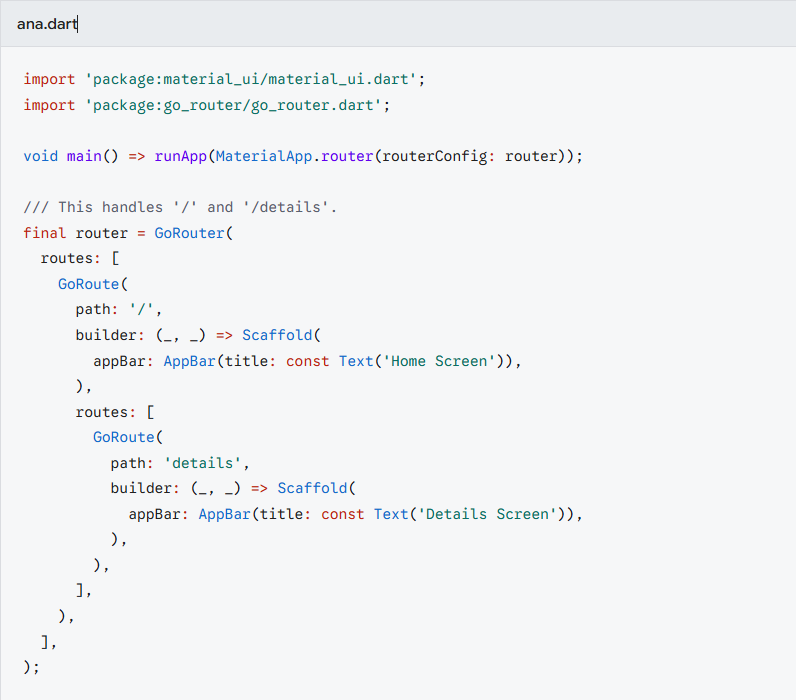

### 2.AndroidManifest.xml Dosyasını Düzenleme

1.  Flutter projesini VS Code veya Android Studio ile açın.

2.  android/app/src/main/AndroidManifest.xml dosyasına gidin.

3.  .MainActivity içeren \<activity\> etiketinin içine aşağıdaki metadata etiketini ve intent-filter'ı ekleyin.

example.com ifadesini kendi web alan adınızla (domain) değiştirin.

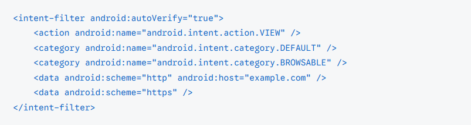

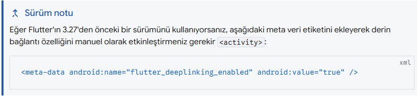

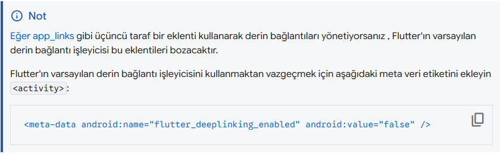

### 3.assetlinks.json Dosyasını Barındırma (Hosting)

Sahibi olduğunuz bir alan adına (domain) sahip bir web sunucusunda bir assetlinks.json dosyası barındırın. Bu dosya, mobil tarayıcıya, tarayıcı yerine hangi Android uygulamasının açılacağını söyler. Dosyayı oluşturmak için, önceki adımda oluşturduğunuz Flutter uygulamasının paket adını ve APK'yı oluşturmak için kullanacağınız imzalama anahtarının sha256 parmak izini alın.

### Paket Adı (Package name)

Paket adını AndroidManifest.xml dosyasında, \<manifest\> etiketinin altındaki package özelliğinde bulun. Paket adları genellikle com.example.\* formatındadır.

### sha256 Parmak İzi (sha256 fingerprint)

İşlem, APK'nın nasıl imzalandığına bağlı olarak değişiklik gösterebilir.

### Google Play Uygulama İmzalamayı Kullanma (Using google play app signing)

sha256 parmak izini doğrudan Play Geliştirici Konsolu'ndan (Play Developer Console) bulabilirsiniz. Uygulamanızı Play Konsolu'nda açın, şunun altında:

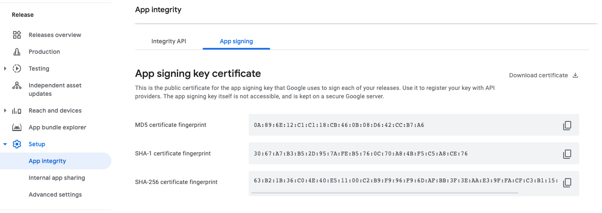

#### 

#### Yerel anahtar deposunu kullanma

Anahtarı yerel olarak saklıyorsanız, aşağıdaki komutu kullanarak sha256 kodunu oluşturabilirsiniz:

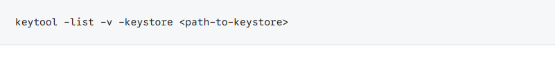

### varlık bağlantıları.json

Barındırılan dosya şu şekilde görünmelidir:

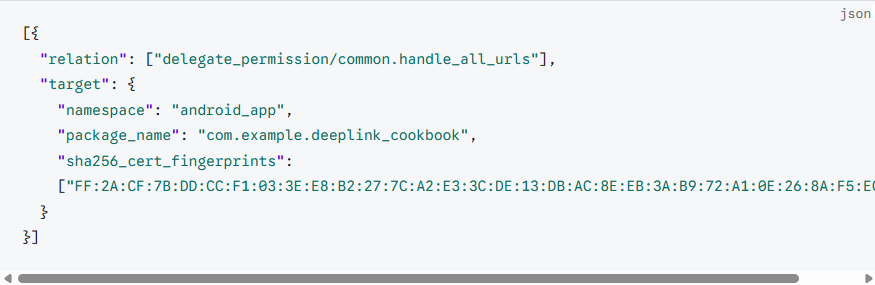

1.  package_name değerini Android uygulama kimliğinize (application ID) ayarlayın.

2.  sha256_cert_fingerprints değerini önceki adımda elde ettiğiniz değerle güncelleyin.

3.  Dosyayı aşağıdakine benzer bir URL'de barındırın: \<webdomain\>/.well-known/assetlinks.json

4.Tarayıcınızın bu dosyaya erişebildiğini doğrulayın.

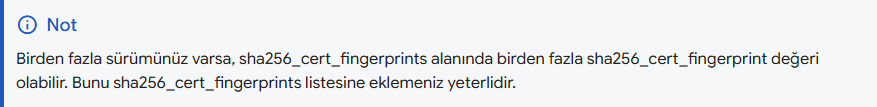

### Test

Bir uygulama bağlantısını (app link) test etmek için gerçek bir cihaz veya Emülatör kullanabilirsiniz; ancak öncelikle cihazlarda en az bir kez flutter run komutunu çalıştırdığınızdan emin olun. Bu, Flutter uygulamasının yüklenmiş olmasını sağlar.

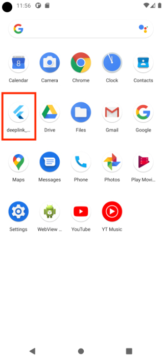

**Yalnızca** uygulama kurulumunu test etmek için adb komutunu kullanın:

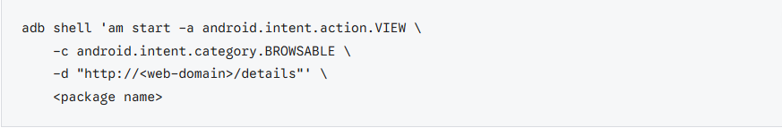

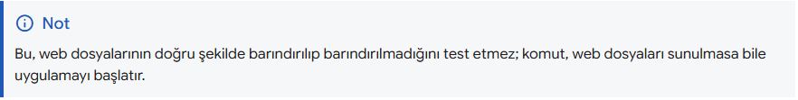

Hem web hem de uygulama kurulumunu test etmek için, bir bağlantıya doğrudan bir web tarayıcısı veya başka bir uygulama üzerinden tıklamanız gerekir. Bunun bir yolu Google Dokümanlar (Google Doc) oluşturmak, bağlantıyı eklemek ve üzerine dokunmaktır.

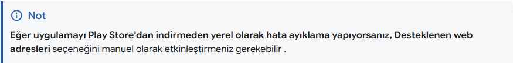

Her şey doğru şekilde ayarlandıysa, Flutter uygulaması başlatılır ve detay ekranını görüntüler:

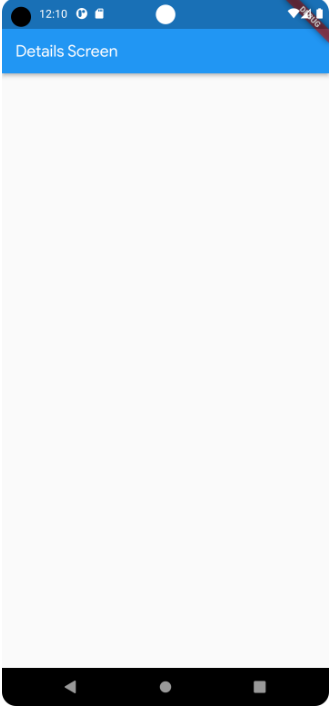

<a id="ios-icin-universal-links-evrensel-baglantilar-ayarlama"></a>

## iOS İçin Universal Links (Evrensel Bağlantılar) Ayarlama

**Flutter ile geliştirilmiş bir iOS uygulaması için evrensel bağlantıların (universal links) nasıl yapılandırılacağını öğrenin.**

Derin bağlantı (deep linking), bir uygulama kullanıcısının bir uygulamayı bir URI ile başlatmasını sağlar. Bu URI şema (scheme), ana bilgisayar (host) ve yol (path) içerir ve uygulamayı belirli bir ekranda açar.

Evrensel bağlantı (universal link), yalnızca iOS cihazlara özgü olan ve yalnızca http veya https protokollerini kullanan bir derin bağlantı türüdür.

Evrensel bağlantıları ayarlamak için bir web alan adınızın (domain) olması gerekir. Geçici bir çözüm olarak Firebase Hosting veya GitHub Pages kullanmayı düşünün.

Derin bağlantılarınızı ayarladıktan sonra bunları doğrulayabilirsiniz. Daha fazla bilgi edinmek için Derin bağlantıları doğrulama bölümüne bakın.

### Bir Flutter Uygulaması Oluşturma veya Düzenleme

Gelen bir URL'yi işleyebilen bir Flutter uygulaması yazın.

Bu örnek, yönlendirmeyi yönetmek için go_router paketini kullanır. go_router paketi Flutter ekibi tarafından sürdürülür ve karmaşık yönlendirme senaryolarını yönetmek için basit bir API sağlar.

1.  Yeni bir uygulama oluşturmak için şunu yazın flutter create \<app-name\>: .

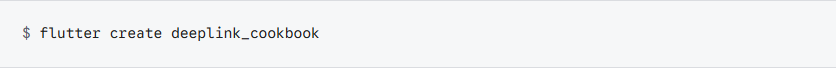

2.  go_routerPaketi bağımlılık olarak eklemek için şu komutu çalıştırın flutter pub add:

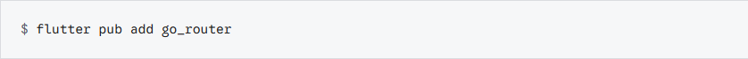

3.Yönlendirmeyi yönetmek için dosyada bir GoRouternesne oluşturun main.dart:

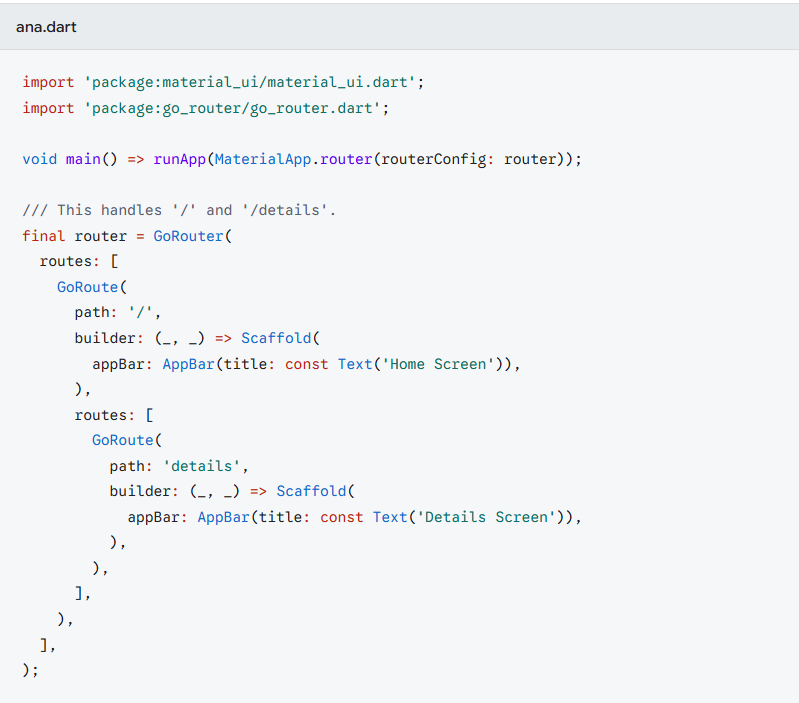

### iOS Derleme Ayarlarını Yapılandırma

1.  Xcode'u başlatın.

2.Flutter projesinin ios klasörü içindeki ios/Runner.xcworkspace dosyasını açın.

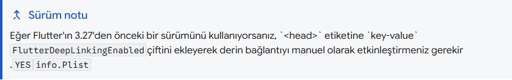

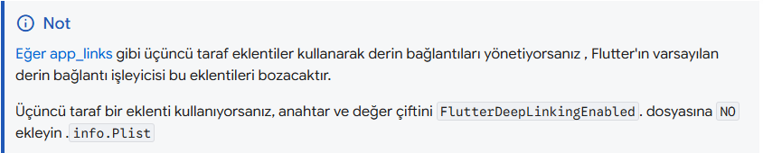

### İlgili etki alanlarını ekleyin

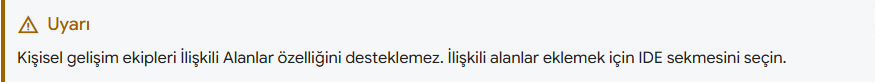


1.  Gerekirse Xcode'u başlatın.

2.  En üst seviyedeki **Runner** öğesine tıklayın.

3.  **Düzenleyicide (Editor)**, Runner hedefine (target) tıklayın.

4.  **Signing & Capabilities** (**İmzalama ve Yetenekler)**sekmesine tıklayın.

5.  Yeni bir alan adı eklemek için **Signing & Capabilities** altındaki + Capability düğmesine tıklayın.

6.Associated Domains seçeneğine tıklayın.

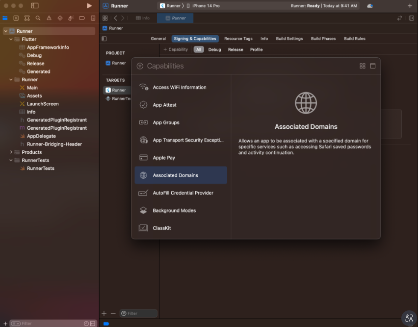

7.Associated Domains bölümünde + düğmesine tıklayın.

8.applinks:\<web domain\> adresini girin. \<web domain\> kısmını kendi alan adınızla değiştirin.


Uygulamanın derin bağlantı yapılandırmasını tamamladınız.


1.  ios/Runner/Runner.entitlementsXML dosyasını tercih ettiğiniz düzenleyici programda açın .

2.Etiketin içine ilgili bir alan adı ekleyin \<dict\>.

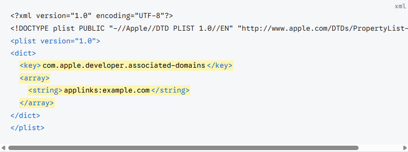

3.  Dosyayı kaydedin ios/Runner/Runner.entitlements.

Oluşturduğunuz ilgili alan adlarının kullanılabilir olup olmadığını kontrol etmek için aşağıdaki adımları uygulayın:

1\. Gerekirse Xcode'u başlatın.

2.En üst seviyedeki Koşucu'ya tıklayın .

3.Editörde, Runner hedefine tıklayın.

4."İmzalama ve Yetenekler" e tıklayın . Alan adları "İlişkili Alan Adları" bölümünde görünmelidir .


Uygulamayı derin bağlantı için yapılandırmayı tamamladınız.

### Uygulamanızı Web Alan Adınızla İlişkilendirme

Web alan adınızda bir apple-app-site-association dosyası barındırmanız gerekir. Bu dosya, mobil tarayıcıya, tarayıcı yerine hangi iOS uygulamasının açılacağını söyler. Dosyayı oluşturmak için, önceki bölümde oluşturduğunuz Flutter uygulamasının appID değerini bulun.

### appID Bileşenlerini Bulma

Apple, appID değerini \<team id\>.\<bundle id\> formatında biçimlendirir:

**-**Paket kimliğini (bundle ID) Xcode projesinden bulun.

**-**Geliştirici hesabından takım kimliğini (team ID) bulun.

**Örneğin:** S8QB4VV633 şeklinde bir takım kimliğiniz ve com.example.deeplinkCookbook şeklinde bir paket kimliğiniz varsa, appID girdisi olarak S8QB4VV633.com.example.deeplinkCookbook değerini girersiniz.

### apple-app-site-association JSON Dosyasını Oluşturma ve Barındırma

Bu dosya JSON formatını kullanır. Dosyayı kaydederken .json uzantısını eklemeyin. Apple'ın belgelerine göre, bu dosya aşağıdaki içeriğe benzer olmalıdır:

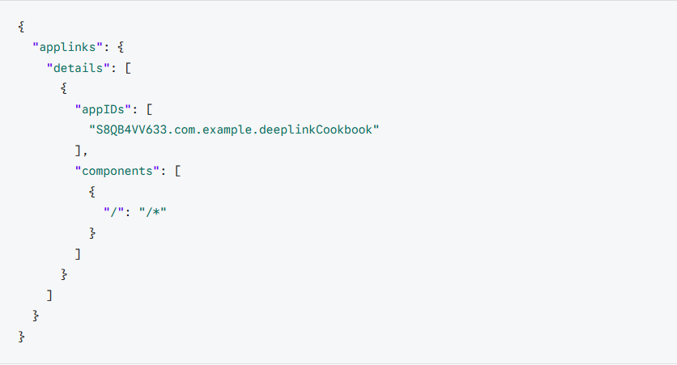

**1.**appIDs dizisindeki bir değeri \<team id\>.\<bundle id\> olarak ayarlayın.

2.  İzin verilen yolları (paths) belirtmek için components dizisini yapılandırın. Bu örnekte / anahtarı URL yolunu temsil eder. /\* değeri, herhangi bir yolu eşleştirir ve Flutter uygulamasına yönlendirir. Gerekirse, yalnızca uygulamanız için uygun yollarla eşleşecek şekilde components dizisini özelleştirin.

**3.**Dosyayı aşağıdaki yapıya benzeyen bir URL'de barındırın:

\<webdomain\>/.well-known/apple-app-site-association

**4.**Tarayıcınızın bu dosyaya erişebildiğini doğrulayın.


### Evrensel Bağlantıyı Test Etme (Test the universal link)

Fiziksel bir iOS cihazı veya Simülatör kullanarak evrensel bağlantıyı test edin.


1.  Test etmeden önce, Flutter uygulamasını iOS cihazınıza veya simülatöre yükleyin ve flutter runistediğiniz cihazda kullanın.


Tamamlandığında, Flutter uygulaması iOS cihazının veya simülatörün ana ekranında görüntülenir.

**2.**Simülatör kullanarak test yapıyorsanız, Xcode CLI'yı kullanın:


**3.**Fiziksel bir iOS cihazıyla test ederseniz:

1.Not uygulamasını başlatın .

2.URL'yi Notlar uygulamasına yazın.

3.Çıkan bağlantıya tıklayın.

Başarılı olursa, Flutter uygulaması başlatılır ve ayrıntılar ekranı görüntülenir.


<a id="web-uzerinde-url-stratejisinin-yapilandirilmasi"></a>

## Web üzerinde URL stratejisinin yapılandırılması

**Web'de karma (hash) veya yol (path) URL stratejilerini kullanın**.

Flutter web uygulamaları, web üzerinde URL tabanlı gezinmeyi (navigation) yapılandırmak için iki farklı yöntemi destekler:

**Hash (Varsayılan)**:

Yollar (paths), hash fragmanı üzerinden okunur ve yazılır.

Örnek: flutterexample.dev/#/path/to/screen

### Path (Yol):

Yollar, hash kullanılmadan okunur ve yazılır.

Örnek: flutterexample.dev/path/to/screen

### URL Stratejisini Yapılandırma

Flutter'ı bunun yerine path (yol) stratejisini kullanacak şekilde yapılandırmak için, Flutter SDK'nın bir parçası olan flutter_web_plugins kütüphanesinin sağladığı usePathUrlStrategy fonksiyonunu kullanın.

flutter_web_plugins kütüphanesini doğrudan pub add kullanarak ekleyemezsiniz. Bunun yerine, pubspec.yaml dosyanıza bir Flutter SDK bağımlılığı olarak dahil edin:

```yaml
dependencies:
  flutter:
    sdk: flutter
  flutter_web_plugins:
    sdk: flutter
```

UsePathUrlStrategy Ardından fonksiyonu önce çağırın runApp:

```dart
import 'package:flutter_web_plugins/url_strategy.dart';

void main() {
  usePathUrlStrategy();
  runApp(ExampleApp());
}
```

### Web Sunucunuzu Yapılandırma

PathUrlStrategy, web sunucuları için ek yapılandırma gerektiren History API'sini kullanır.

Web sunucunuzu PathUrlStrategy'yi destekleyecek şekilde yapılandırmak için, istekleri index.html dosyasına yeniden yönlendirmek (rewrite) üzere sunucu belgelerinizi kontrol edin. Tek sayfalık uygulamaların (SPA) nasıl yapılandırılacağı hakkında detaylar için sunucunuzun kılavuzuna bakın.

Firebase Hosting kullanıyorsanız, projenizi başlatırken "Configure as a single-page app" (Tek sayfalık uygulama olarak yapılandır) seçeneğini seçin. Daha fazla bilgi için Firebase'in yeniden yazma (rewrites) belgelerine bakın.

flutter run -d chrome komutu çalıştırılarak oluşturulan yerel geliştirme sunucusu, herhangi bir yolu sorunsuz bir şekilde ele alacak ve uygulamanın index.html dosyasına geri dönecek (fallback) şekilde yapılandırılmıştır.

### Flutter Uygulamasını Kök Dışı (Non-root) Bir Konumda Barındırma

web/index.html dosyasındaki \<base href="/"\> etiketini, uygulamanızın barındırıldığı yola göre güncelleyin. Örneğin, Flutter uygulamanızı my_app.dev/flutter_app adresinde barındırmak için bu etiketi \<base href="/flutter_app/"\> olarak değiştirin.

Göreceli (relative) taban href etiketleri sürüm (release) derlemeleri için desteklenir, ancak sayfanın sunulduğu tam URL'yi dikkate almaları gerekir. Bu, /flutter_app/, /flutter_app/nested/route ve /flutter_app/nested/route/ istekleri için göreceli bir taban href değerinin farklı olacağı anlamına gelir (örneğin sırasıyla ., .. ve ../..).


---

## Görsellerin görüntülenmesi hakkında

Bu Markdown dosyasında kalan görseller `2026-guz-navigation-routing-gorseller/` klasöründen göreli yollarla çağrılır. Görsellerin GitHub üzerinde çıkması için `.md` dosyasıyla bu klasör **aynı dizinde** tutulmalıdır. Sadece `.md` dosyasını ayrı bir konuma taşımak görselleri kırar.
